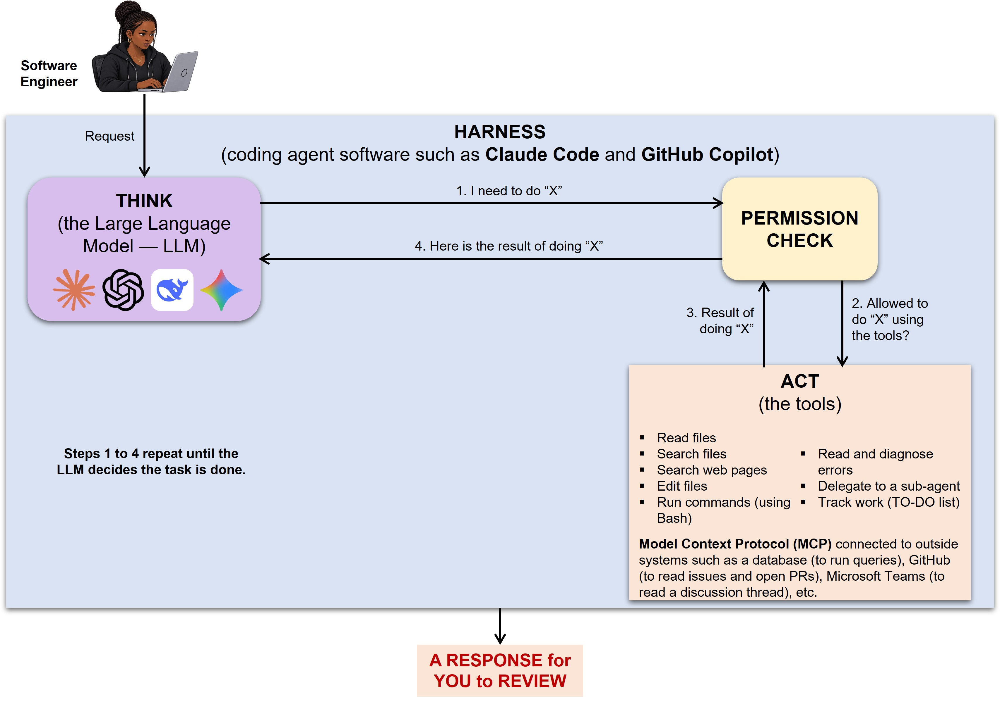

# How coding agents and model APIs work, and the files that control them

Read this guide in **Step 2** of the lab, whichever track you chose, and
return to Section 6 at the start of Part D. It explains
the process you will follow and every file you will create. It applies to both
Claude Code and GitHub Copilot; where they differ, both are shown.

---

## 1. What a coding agent is

**A coding agent is a Large Language Model (LLM) connected to tools by agent
software (the harness), such as Claude Code or GitHub Copilot. The LLM reads
your request and decides what to do next. When it needs to read a file, edit
code or run a command, it asks the harness to use the right tool. The harness
checks your permission settings, runs the tool, and returns the result to the
LLM. This repeats until the task is done.**

Unlike a chatbot that only suggests code, an agent can read your files, search
the project, edit files, run commands such as your tests, look at the results,
and try again. **It works in a loop.**



An LLM on its own can only read text and write text. It cannot open a file,
run a test or change your code. **The harness is the program wrapped around
the LLM that gives it those abilities, safely.** Claude Code and GitHub
Copilot are examples of harnesses. The LLM inside them is the “brain”; the
harness is everything else.

The harness has four jobs:

1. **It sends your request to the LLM**, together with the project instruction
   file (`CLAUDE.md` or `copilot-instructions.md`) and a list of the tools that
   are available.
2. **It receives the LLM's tool requests.** When the LLM needs a file, it does
   not open the file itself. It replies with a structured request, such as
   “use the read tool in `invoices.py`”.
3. **It checks your permissions, then runs the tool.** This is where the
   harness stops and asks you to approve an edit or a command if it is running
   in "Manual Mode". If you refuse, the tool never runs.
4. **It returns the result to the LLM** (the file contents, the test output, the
   error message, etc.). The LLM reads it and decides the next step. **The loop
   repeats until the LLM reports that it has finished.**

**Analogy:** Think of a senior consultant working remotely who cannot visit
your office. The consultant (the LLM) phones your office assistant (the
harness) and says, "Please read me the invoice file." The assistant checks
whether the consultant is allowed to see it, fetches it, and reads it out. Then
the consultant says, "Now change line 92." The assistant asks you for approval
first, makes the change, and confirms it. The consultant does the thinking. The
assistant does the actions and enforces your rules.

The **Model Context Protocol (MCP)** is an open standard for connecting a
coding agent to outside systems. Examples include a database (to inspect
schemas and run queries), GitHub (to read issues and open pull requests), a
project tracker such as Jira (to read a ticket's requirements), documentation
in Confluence or Google Drive, error monitoring such as Sentry (to diagnose
bugs), and a browser automation tool such as Playwright (to test a web
application). Each MCP server adds its own tools to the agent.

Each MCP connection gives the agent real access to a real system, so apply a
least-privilege rule: only grant the minimum permissions necessary. Example:
Connect a read-only database user rather than an administrator, and a test
environment rather than production. Text the agent reads from these systems,
such as an issue or a Slack message, can also contain prompt injection, which
links to later steps in this lab.

Four facts follow from this, and the whole lab is built around them:

1. **The agent is fluent, not infallible (error-free).** It produces the most
   plausible next step. Its mistakes look exactly as confident as its successes.
2. **The agent only knows what is in its context window**, the text it can see right
   now: your request, the files it has read, tool output, and its instruction
   files. It does not remember yesterday's chat unless something is written down.
3. **The agent optimizes for what you ask.** "Make the tests pass" can be satisfied by
   deleting a test. Say precisely what you want and what must not change.
4. **YOU ARE ACCOUNTABLE.** Whoever typed the code, the person who commits it owns it.

---

## 2. The process: How a proficient developer works with an agent

```
Explore ──> Specify ──> Plan ──> Test First ──> Implement ──> Review ──> Commit
   ▲                                                            │
   └──────────────────── reject and revise <────────────────────┘
```

| Stage | What you do | What the agent does | Lab step |
|-------|-------------|---------------------|----------|
| Explore | Ask questions; verify the answers in the code | Reads and summarises the codebase | 3 |
| Configure | Write the project instruction file | Follows it in every session | 4 |
| Specify | Decide the behaviour, edge cases and acceptance criteria | Critiques the specification for gaps (optional) | 6 |
| Plan | Approve or correct the plan | Proposes files to change and steps | 7 |
| Test first | Check that tests encode the specification | Writes tests that fail for the right reason | 5, 8 |
| Implement | Review every change; reject what is wrong | Edits code until the tests pass | 8 |
| Manage context | Start fresh chats; point at the right files | Works from what is in its context | 9 |
| Review | Use a checklist and a second, independent reviewer | Acts as a read-only reviewer when asked | 10, 12 |
| Commit | Write a meaningful commit and a log entry | **Nothing: this is YOUR decision** | every step |

The six skills you are building: **specify, plan, delegate, verify, review, own.**

---

## 3. The key files

Agents are configured with plain Markdown files kept in the project. There are
three kinds you must understand. Think of them as layers.

| Layer | Purpose | When it is loaded | Analogy |
|-------|---------|-------------------|---------|
| **Project instructions** | Standing rules and facts about the project | At the start of **every** session | The briefing every new team member reads |
| **Skill** (`SKILL.md`) | A detailed procedure for one kind of task | **Only when relevant**, or when you type `/skill-name` | A standard operating procedure in a binder |
| **Custom agent / subagent** | A specialist with its own instructions and limited tools | When you, or the main agent, delegate to it | A colleague you ask for a second opinion |

### Where each file lives

| Purpose | Claude Code | GitHub Copilot in VS Code |
|---------|-------------|---------------------------|
| Project instructions | `CLAUDE.md` in the project root | `.github/copilot-instructions.md` (Copilot also reads `AGENTS.md` and `CLAUDE.md`) |
| Personal, uncommitted instructions | `CLAUDE.local.md` (gitignored) | Personal instructions in your user profile or `~/.copilot/` |
| Skill | `.claude/skills/<name>/SKILL.md` | `.github/skills/<name>/SKILL.md` (Copilot also reads `.claude/skills/` and `.agents/skills/`) |
| Custom agent / subagent | `.claude/agents/<name>.md` | `.github/agents/<name>.agent.md` (Copilot also reads Claude-format files in `.claude/agents/`) |
| Cross-tool instructions | `AGENTS.md` (read if no `CLAUDE.md`, or if imported) | `AGENTS.md` |

Because the formats overlap, what you learn in one tool transfers to the other.
`AGENTS.md` and `SKILL.md` are open conventions used by several agents.

### What makes these files good

- **Short and specific beats long and vague.** Every line of the project
  instruction file is read in every session. "Use `Decimal` for money" is
  useful; "write clean code" is noise.
- **Rules the agent cannot discover by itself.** It can read your code; it
  cannot read your client's mind. Business rules, conventions and "never do
  this" rules belong here.
- **A skill's `description` decides when it is used.** Write it as "what this
  does, and when to use it".
- **Least privilege for subagents.** A reviewer only needs to read, so give it
  read and search tools only.
- **Treat them as code.** Review changes to them, commit them, and improve them
  when the agent makes the same mistake twice.

---

## 4. Are these files public? Can they be private?

**Short answer:** these files are ordinary files in your repository. If you
commit them to a **public** repository, anyone can see them, and they make it
obvious that you use a coding agent. They can be kept private, but for
academic work you should let it be known that you used a coding agent. Similar
to the requirement that you should cite sources in academic work.

### What is visible, and what is not

| Item | Committed? | Who can see it |
|------|-----------|----------------|
| `CLAUDE.md`, `.github/copilot-instructions.md`, `AGENTS.md` | Usually yes | Anyone who can see the repository |
| `.claude/skills/`, `.github/skills/`, `.claude/agents/`, `.github/agents/` | Usually yes | Anyone who can see the repository |
| `CLAUDE.local.md`, `.claude/settings.local.json` | No (gitignored in this repository) | Only you, on your machine |
| `.env` (your model API keys, Part D) | **Never** (gitignored in this repository) | Only you, on your machine |
| `.env.example` (setting names, no values) | Yes | Anyone who can see the repository |
| `logs/llm_usage.csv`, `evals/results/` | No (gitignored) | Only you |
| User-level files: `~/.claude/...`, `~/.copilot/...`, VS Code profile settings | No (outside the repository) | Only you |
| Your chat conversations | No (not in Git) | You, and the provider under its terms |
| Commit messages that mention AI, such as `Co-Authored-By:` lines | Yes, if you write them | Anyone who can see the history |

### Ways to keep agent configuration private

1. **Make the repository private.** GitHub allows free private repositories.
   Collaborators you invite can still see everything.
2. **Use personal, uncommitted files.** Put personal preferences in
   `CLAUDE.local.md` or your user-level folder instead of the project.
3. **Exclude files locally** by listing them in `.git/info/exclude` (works like
   `.gitignore` but is never committed).
4. **Never commit secrets** in any of these files. A private repository is not a
   safe place for passwords or API keys either.

### Why, in this lab, you should commit them

- **They are part of your submission.** Your instruction file, skill and
  subagent are assessed.
- **Disclosure is part of academic integrity.** Your AI use log and these
  files show honestly how you worked.
- **It is normal professional practice.** Teams commit these files so that
  everyone, and every agent, follows the same rules. **Using an agent openly and
  professionally is a strength to show employers, *NOT* something to hide.**

What you **must** keep private: secrets, personal data, and anything your
lecturer has not authorised you to share. Step 13 asks you to decide, for each
file you created, whether it should be committed, and why.

---

## 5. Common failure patterns to watch for

| Pattern | What it looks like | How to catch it |
|---------|-------------------|-----------------|
| Plausible but wrong | Correct-looking code that breaks a business rule | Work one example by hand |
| Summarising instead of reading | Repeats the docstring, misses what the code does | Ask for line numbers; check them |
| Gaming the tests | Edits, weakens or deletes a test to make it pass | Rule in instructions; review test diffs |
| Tautological tests | Expected value computed by the code under test | Expected values come from the specification |
| Invented APIs or packages | Imports something that does not exist | Check every new import before installing |
| Silent failure | `except Exception: return 0` | Search diffs for broad `except` |
| Stale "facts" | "The current exchange rate is..." | The agent cannot know today's data |
| Scope creep | Changes files you did not ask about | Review the list of changed files first |
| Context drift | Forgets rules late in a long chat | Start a new chat per task |

---

## 6. Calling a model from your own code (Part D)

Using a coding agent and calling a model API are different skills. With an
agent, the model helps **you** write code. With an API, **your program**
sends text to the model and uses the answer, for example to read a
customer's message.

```text
 your program ──HTTPS request (key in a header, JSON body)──> model provider
              <──JSON response (text, token counts)──────────
```

### The files involved

| File | Purpose | Committed? |
|------|---------|-----------|
| `.env` | Your API key and which provider and model to use | **Never** |
| `.env.example` | The names of the settings, with no values, so others know what to set | Yes |
| `sales_toolkit/ai/llm_client.py` | The adapter: one `generate()` method for every provider | Yes |
| `evals/order_cases.jsonl` | Labelled examples used to measure quality | Yes |
| `evals/holdout_cases.jsonl` | Examples kept back to detect overfitting | Yes (after the final run) |
| `logs/llm_usage.csv` | Tokens and time for every call, for cost estimates | No |

### Principles that apply to any model, from any provider

1. **Keep the model's job narrow.** Let it do what only a language model can
   do (understand messy language). Let ordinary code do everything that can
   be done exactly (prices, totals, business rules).
2. **Never trust the output.** Validate it exactly as you would validate
   input typed by a stranger.
3. **Separate instructions from data.** Rules go in the system prompt; the
   untrusted text goes in the user message, clearly marked.
4. **Assume the model can be fooled.** Design so that a fooled model cannot
   cause harm (prompt injection).
5. **Measure, do not assume.** Build an evaluation set, change one thing at a
   time, and analyse failures by cause.
6. **Test without the network.** Unit tests use a fake client; evaluations
   use the real model.
7. **Plan for failure.** Timeouts, retries with backoff, rate limits, and
   clear messages when something goes wrong.
8. **Protect secrets and personal data.** Keys in `.env`; only send data the
   provider's terms and the law allow.
9. **Know the cost.** Tokens in and out, multiplied by the current price.

### Additional failure patterns for AI features

| Pattern | What it looks like | How to catch it |
|---------|-------------------|-----------------|
| Trusting the model with money | Prices or totals taken from the model's reply | Prices only from your own data |
| Prompt injection | A message that says "ignore your instructions" changes behaviour | Injection cases in the evaluation; design limits |
| Invalid structure | Prose or code fences instead of JSON | Strip fences, validate, retry once, then flag |
| Overfitting the prompt | Great on your examples, poor on new ones | A hold-out set run only at the end |
| Leaked keys | A key in code, a commit, a log or a screenshot | `.env`, `git check-ignore`, history search |
| Silent cost growth | Long prompts sent thousands of times | Log tokens per call; estimate monthly cost |

